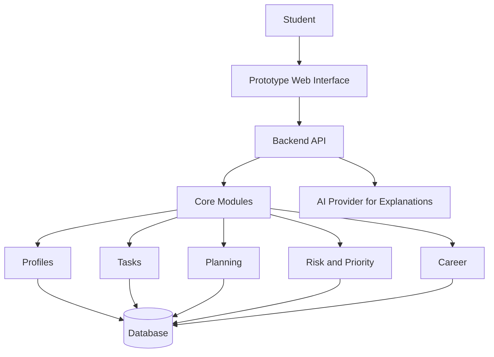
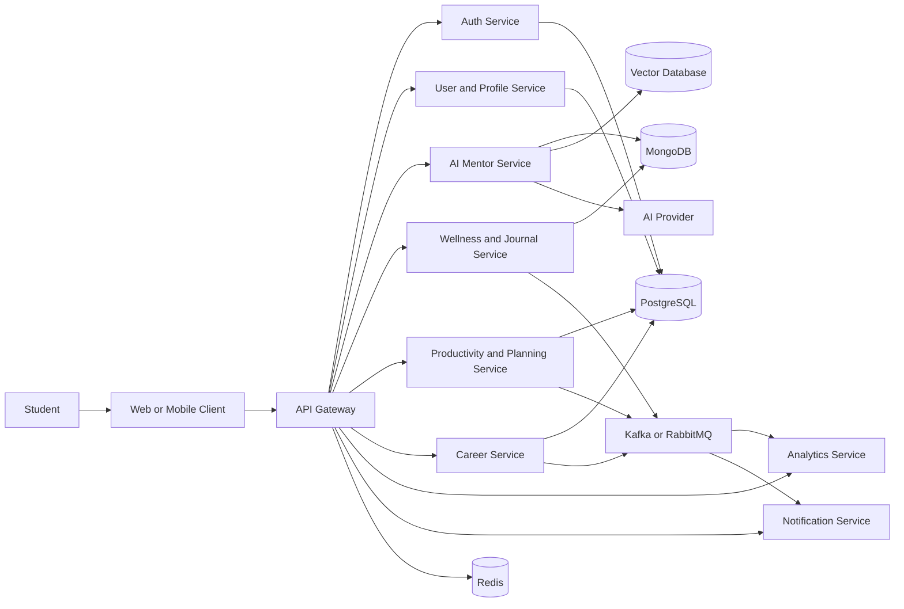

# LumaPath AI

> **Know what to do next. Stay on track. Build your future.**

LumaPath AI is an adaptive Student Success and Career Readiness platform that combines academic planning, personal capacity, skills, and career goals to help students decide what to do next and continuously adapt their path.

**hackX 11.0 — ideaX Semi-Final Project**

> **Development note:** this repository currently contains product and prototype documentation only. The application features and technical architecture described below are planned unless explicitly marked otherwise.

## Contents

- [LumaPath AI](#lumapath-ai)
  - [Contents](#contents)
  - [Overview](#overview)
  - [The Problem](#the-problem)
  - [The Solution](#the-solution)
  - [Core Product Promise](#core-product-promise)
  - [hackX 11.0 Prototype](#hackx-110-prototype)
    - [Prototype Scope](#prototype-scope)
    - [Prototype Status](#prototype-status)
  - [Prototype Demo Flow](#prototype-demo-flow)
  - [Full Product Vision](#full-product-vision)
    - [Academic Success](#academic-success)
    - [AI Planning](#ai-planning)
    - [Student Wellness and Capacity](#student-wellness-and-capacity)
    - [Productivity](#productivity)
    - [Career Growth](#career-growth)
    - [AI Mentor and Learning](#ai-mentor-and-learning)
    - [Career Intelligence](#career-intelligence)
    - [Analytics and Notifications](#analytics-and-notifications)
    - [Integrations and Platform](#integrations-and-platform)
  - [AI and Decision Intelligence](#ai-and-decision-intelligence)
  - [System Architecture](#system-architecture)
    - [Competition Prototype Architecture](#competition-prototype-architecture)
    - [Target Production Architecture](#target-production-architecture)
    - [Target Data Strategy](#target-data-strategy)
  - [Target Tech Stack](#target-tech-stack)
    - [Engineering Direction](#engineering-direction)
  - [Security and Responsible Support](#security-and-responsible-support)
  - [Getting Started](#getting-started)
  - [Project Structure](#project-structure)
  - [Current Development Status](#current-development-status)
  - [Roadmap](#roadmap)
    - [Milestone 1 — Competition Foundation](#milestone-1--competition-foundation)
    - [Milestone 2 — Core Decision Loop](#milestone-2--core-decision-loop)
    - [Milestone 3 — Career Readiness](#milestone-3--career-readiness)
    - [Milestone 4 — Broader Student Platform](#milestone-4--broader-student-platform)
    - [Milestone 5 — Scale and Operations](#milestone-5--scale-and-operations)
  - [Team](#team)
  - [Future Vision](#future-vision)
  - [License](#license)
- [LumaPath AI](#lumapath-ai-1)
  - [Run locally](#run-locally)
  - [Checks](#checks)

## Overview

LumaPath AI is envisioned as a student life operating system: one place for academic productivity, wellbeing and capacity awareness, task management, adaptive planning, AI mentoring, career development, and evidence-based skill progress.

The platform is intended to understand a student's:

- academic workload and deadlines;
- available time and current capacity;
- skills and evidence of progress;
- career goal and learning progress.

It can then help the student identify a realistic next action, understand why that action matters, and adjust the plan as circumstances change.

## The Problem

University students often manage coursework, deadlines, wellbeing, skill development, and internship preparation across disconnected tools. A static to-do list may show what is due, but it does not account for changing capacity, competing deadlines, career goals, or the evidence needed to demonstrate progress.

This fragmentation makes it difficult to answer a simple but important question: **What should I do next?**

## The Solution

LumaPath brings academic and career context into one adaptive workflow. The intended product combines:

- a personalised student profile;
- academic tasks, goals, habits, and deadlines;
- daily capacity, mood, and stress check-ins;
- deadline risk and priority analysis;
- weekly planning and automatic replanning;
- career readiness, skill-gap analysis, and personalised pathways;
- explainable AI guidance, reminders, and progress insights.

## Core Product Promise

```text
Student Context
      ↓
Tasks + Deadlines + Capacity + Skills + Career Goal
      ↓
Risk & Priority Analysis
      ↓
Adaptive Planning
      ↓
Next Best Action
      ↓
AI Explanation
      ↓
Progress & Replanning
```

The product is guided by one engineering principle:

> **Rules decide. Optimisation schedules. AI explains.**

- Structured logic determines priority, constraints, and deadline risk.
- Planning logic creates realistic schedules from the student's time and capacity.
- AI provides explanations, guidance, and personalised communication.
- Critical scheduling decisions should remain traceable rather than being controlled blindly by a language model.

## hackX 11.0 Prototype

The current milestone is a focused prototype for the **hackX 11.0 ideaX Semi-Finals**, part of the Inter-University Startup Challenge. It is intended to demonstrate the central decision loop within the competition's short pitch-and-demo format, not the complete long-term platform.

### Prototype Scope

- Student profile and career target
- Task and deadline manager
- Daily capacity check-in
- Deadline risk detection
- Next Best Action recommendation
- AI weekly planning
- Automatic plan rescheduling
- Explainable recommendations
- Career skill-gap analysis
- Career readiness view

Detailed scope boundaries and acceptance criteria are recorded in [docs/prototype-scope.md](docs/prototype-scope.md).

### Prototype Status

| Feature | Status |
| --- | --- |
| Student Dashboard | Planned |
| Student Profile | Planned |
| Task Manager | Planned |
| Capacity Check-In | Planned |
| Deadline Risk | Planned |
| Next Best Action | Planned |
| Weekly Planner | Planned |
| Automatic Replanning | Planned |
| Skill-Gap Analysis | Planned |
| Explainable Recommendations | Planned |
| Career Readiness | Planned |

These statuses describe what is present in this repository. They should be updated only when the corresponding implementation is committed and verifiable.

## Prototype Demo Flow

The proposed demo follows **Maya**, a student working toward a career as a DevOps Engineer:

1. Maya's student profile and career target are shown.
2. Her academic tasks and deadlines are loaded.
3. Maya records her current available time and capacity.
4. LumaPath identifies a deadline at risk.
5. It recommends her Next Best Action.
6. A realistic weekly plan is generated.
7. An exam or deadline changes.
8. LumaPath replans the affected work.
9. An explanation shows why the priorities changed.
10. The career view identifies Maya's next missing DevOps skill.

## Full Product Vision

The prototype is only the first decision loop. The complete product vision retains the broader academic, wellbeing, productivity, mentoring, and career capabilities below.

**Legend:** **Prototype Core** is in the competition scope; **Planned** belongs to the broader product; **Advanced / Future** is a later-stage capability. These labels describe scope, not completed implementation.

### Academic Success

- **Prototype Core:** student dashboard and personalised profile
- **Prototype Core:** academic tasks, deadlines, deadline alerts, and risk detection
- **Prototype Core:** weekly study plan, Next Best Action, and automatic replanning
- **Planned:** academic details, daily goals, study goals, and learning guidance
- **Planned:** focus-session and study-progress tracking
- **Advanced / Future:** university LMS and calendar integrations

### AI Planning

- **Prototype Core:** priority recommendations based on deadlines and capacity
- **Prototype Core:** explainable recommendations and plan changes
- **Planned:** personalised improvement plans and learning recommendations
- **Planned:** smart reminders and motivational support
- **Advanced / Future:** recommendation optimisation informed by long-term outcomes

### Student Wellness and Capacity

- **Prototype Core:** daily capacity check-in
- **Planned:** mood and stress tracking
- **Planned:** daily journaling and reflection history
- **Planned:** burnout signals and emotional trend analysis
- **Planned:** safety-aware supportive guidance
- **Advanced / Future:** counsellor or authorised support dashboards with appropriate consent and safeguards

### Productivity

- **Prototype Core:** task and plan management
- **Planned:** goal tracking and productivity summaries
- **Planned:** habits, habit streaks, and focus sessions
- **Planned:** study planning and productivity coaching
- **Planned:** event-driven notifications and nudges

### Career Growth

- **Prototype Core:** career target, readiness view, and skill-gap analysis
- **Prototype Core:** personalised career pathway and next skill recommendation
- **Planned:** internship preparation and skill roadmaps
- **Planned:** resume/CV tracking and improvement support
- **Planned:** interview preparation and coding-challenge planning
- **Planned:** portfolio development and evidence-based skill progress
- **Planned:** GitHub progress tracking and LinkedIn growth tracking

### AI Mentor and Learning

- **Planned:** conversational AI mentor
- **Planned:** academic, productivity, and career guidance
- **Planned:** context-aware memory and personalised recommendations
- **Planned:** internship and resume guidance
- **Planned:** emotional support guidance within clearly defined safety boundaries
- **Advanced / Future:** retrieval-augmented guidance using approved student context

### Career Intelligence

- **Planned:** career-readiness scoring with transparent contributing factors
- **Planned:** skill demand and pathway insights
- **Planned:** learning-resource recommendations
- **Advanced / Future:** labour-market and internship intelligence from trusted data sources

### Analytics and Notifications

- **Planned:** productivity and learning-progress insights
- **Planned:** mood, stress, and behavioural trend views
- **Planned:** deadline, study, career, and habit reminders
- **Planned:** AI-generated encouragement with user controls
- **Advanced / Future:** privacy-aware institutional insights using aggregated data

### Integrations and Platform

- **Planned:** GitHub, calendar, email, and push-notification integrations
- **Advanced / Future:** university LMS integration
- **Advanced / Future:** team study groups and mobile applications
- **Advanced / Future:** admin and counsellor experiences
- **Advanced / Future:** premium SaaS capabilities and multi-region deployment

## AI and Decision Intelligence

The initial decision design separates deterministic product logic from generative AI:

1. **Context:** collect explicit profile, workload, deadline, capacity, skill, and career-goal inputs.
2. **Risk:** use auditable rules to flag deadline pressure and constraint conflicts.
3. **Priority:** rank feasible actions using declared factors rather than hidden model judgment.
4. **Plan:** allocate work into available time and recalculate when inputs change.
5. **Explain:** use AI to turn the structured result into clear, personalised guidance.
6. **Learn:** record outcomes and evidence so future recommendations can improve safely.

Longer-term AI concepts include context memory, embeddings, vector search, RAG, response caching, prompt-injection defenses, and a safety layer. These are target capabilities; no AI provider or algorithm has been implemented in this repository.

## System Architecture

### Competition Prototype Architecture

Because application development has not yet started, the prototype architecture remains intentionally technology-neutral:



The first implementation should stay modular but small: one web application, one backend boundary, one database, and an optional AI provider for explanations.

### Target Production Architecture

The long-term architecture may evolve into independently deployable services once real scale and team needs justify that complexity.



This is a **target architecture**, not the current repository structure. Possible service responsibilities include authentication, profiles, AI mentoring, journaling, productivity and planning, career readiness, analytics, notifications, and external integrations.

### Target Data Strategy

- **PostgreSQL:** users, profiles, goals, habits, tasks, plans, skills, career pathways, notifications, roles, and permissions
- **MongoDB:** flexible journal entries, mood logs, conversation history, and summaries where document storage is justified
- **Redis:** sessions, rate limits, short-lived plan data, and response caching
- **Vector database:** approved context embeddings and retrieval data for future RAG features

The prototype should begin with the smallest data store that meets its needs rather than introducing every planned database.

## Target Tech Stack

No framework or dependency has been installed yet. The original technical direction is retained here as a candidate stack to validate before implementation.

| Area | Target / Candidate Technologies | Current State |
| --- | --- | --- |
| Frontend | Next.js, TypeScript, Tailwind CSS, Framer Motion, Zustand or Redux | Not started |
| Backend | Node.js, NestJS, REST, DTO validation, OpenAPI | Not started |
| Data | PostgreSQL; later MongoDB, Redis, and a vector database where justified | Not started |
| Messaging | Kafka or RabbitMQ for later event-driven workflows | Not started |
| AI | Provider API, RAG, embeddings, context memory, safety layer | Not started |
| Delivery | Docker, Docker Compose, GitHub Actions, Nginx | Not started |
| Scale | Kubernetes and cloud deployment on an evaluated provider | Future target |
| Observability | Prometheus, Grafana, ELK, OpenTelemetry | Future target |

Potential production metrics include API latency, error rates, planning and AI response time, AI token usage, message-consumer lag, query performance, cache hit rate, and notification delivery rate.

### Engineering Direction

As the system grows, it may apply SOLID, DRY, KISS, clean or hexagonal architecture, domain-driven design, repository and service-layer patterns, dependency injection, CQRS where useful, and event-driven integration. Distributed-system concerns such as retries, circuit breakers, graceful degradation, horizontal scaling, load balancing, eventual consistency, observability, and fault tolerance belong to later phases—not the initial prototype.

## Security and Responsible Support

Planned security controls include:

- secure authentication, password hashing, session or token rotation, and role-based access;
- input validation, request sanitisation, rate limiting, and audit logging;
- HTTPS/TLS, protected environment variables, secrets management, and encryption practices;
- explicit consent and strong access controls for journal, mood, stress, and career data;
- prompt-injection defenses and controlled context retrieval for AI features;
- transparent recommendation factors and user control over reminders and personalisation.

LumaPath is intended to provide supportive guidance only. It must not present itself as a replacement for medical, psychological, academic, legal, or professional counselling services. Crisis handling and escalation require dedicated safety design before wellness AI is released.

## Getting Started

Clone the documentation repository:

```bash
git clone https://github.com/IT24103430/LumaPath-AI.git
cd LumaPath-AI
```

The browser-local prototype is runnable: use `npm ci`, then `npm run dev`. Run `npm run lint`, `npm run typecheck`, `npm test`, and `npm run build` for checks. Run `npm run test:e2e` for the Playwright journeys. No database, backend credentials, or Docker setup is required. See [the integration report](docs/prototype-integration.md) for current capabilities and limitations.

## Project Structure

The current repository is deliberately small:

```text
LumaPath-AI/
├── docs/
│   └── prototype-scope.md
└── README.md
```

The earlier multi-application, infrastructure, Kubernetes, Terraform, and CI/CD layouts remain possible future directions, but those directories do not exist yet.

## Current Development Status

| Area | Status | Evidence in Repository |
| --- | --- | --- |
| Product vision | Documented | This README |
| hackX prototype scope | Documented | `docs/prototype-scope.md` |
| Prototype user flow | Documented | This README and scope document |
| Frontend | Planned | No application code yet |
| Backend and APIs | Planned | No application code yet |
| Database | Planned | No schema or configuration yet |
| AI integration | Planned | No provider integration yet |
| Authentication | Planned beyond initial prototype | No implementation yet |
| Testing and CI/CD | Planned | No test or workflow configuration yet |
| Deployment and observability | Advanced / Future | No infrastructure configuration yet |

## Roadmap

### Milestone 1 — Competition Foundation

- [x] Clarify the full product vision and focused prototype scope
- [x] Document the demo story and honest implementation status
- [ ] Confirm the prototype technology stack
- [ ] Create the minimal application foundation
- [ ] Add a representative demo data set for Maya

### Milestone 2 — Core Decision Loop

- [ ] Build the student profile and dashboard
- [ ] Build task and deadline management
- [ ] Add capacity check-in and deadline-risk rules
- [ ] Implement Next Best Action ranking
- [ ] Generate and replan a weekly schedule
- [ ] Explain recommendation factors clearly

### Milestone 3 — Career Readiness

- [ ] Model career targets, skills, and evidence
- [ ] Add skill-gap analysis and a personalised pathway
- [ ] Show career-readiness progress without unsupported claims

### Milestone 4 — Broader Student Platform

- [ ] Add goals, habits, focus sessions, mood, stress, and journaling
- [ ] Add AI mentor, resume/CV, interview, internship, and learning support
- [ ] Add GitHub, calendar, notification, and other approved integrations
- [ ] Validate privacy, accessibility, safety, and recommendation quality

### Milestone 5 — Scale and Operations

- [ ] Introduce service separation only where operationally justified
- [ ] Add caching, messaging, and specialised data stores as needed
- [ ] Add containerisation, CI/CD, monitoring, logging, and tracing
- [ ] Evaluate Kubernetes and multi-region deployment when scale requires them

## Team

| Team Member | Role |
| --- | --- |
| [Sachith Asmadala](https://github.com/Sachith-02) | Team Member |
| Dasun Weliange | Team Member |
| Sudesh Sumanawansha | Team Member |
| Buddi Jayasundara | Team Member |

Roles will be updated as responsibilities are confirmed.

Repository: [github.com/IT24103430/LumaPath-AI](https://github.com/IT24103430/LumaPath-AI)

## Future Vision

LumaPath AI aims to grow from a focused planning prototype into a trusted student-success platform connecting academic action, personal wellbeing, and career development. Future opportunities include mobile apps, team study groups, authorised counsellor and institutional experiences, richer career intelligence, a responsible recommendation engine, cloud deployment, and sustainable SaaS offerings.

The architecture should evolve with validated user needs. Microservices, multiple databases, event streaming, and Kubernetes are options for future scale—not measures of prototype success.

## License

No license file has been added yet. Until a license is selected and committed, normal copyright restrictions apply. The team can evaluate the MIT License or another suitable license in a future update.

# LumaPath AI

LumaPath helps students connect academic deadlines, an adaptive day plan, and career readiness. The current app uses a deterministic local student scenario. After onboarding, shared student progress is saved in this browser and survives reloads; Demo Reset starts a fresh journey.

## Run locally

Use Node.js 20.20.2 or newer and npm. This repository has a `package-lock.json` and uses npm as its package manager.

```bash
npm ci
npm run dev
```

Open the URL printed by Next.js. It is usually <http://localhost:3000>; if that port is busy, Next.js prints another port such as 3001.

The `pnpm` command installed on some Macs may require a newer Node.js version. With Node 20 and Homebrew pnpm 11, `node:sqlite` fails before the app starts. Use `npm run dev` for this repository. If you choose to use pnpm in another project, install a pnpm version compatible with your Node.js version.

The app is on Next.js 15. Its development output goes to `.next-dev`, while production builds go to `.next`, so `npm run build` can run without deleting files used by a live development server. If a server started before this change still reports a missing `_buildManifest.js.tmp` file, stop that server and start `npm run dev` again. Run only one development server for this checkout at a time.

The PostCSS override in `package.json` patches the version nested under Next.js 15; `npm audit` now reports zero vulnerabilities without a major Next.js upgrade.

## Checks

```bash
npm run lint
npm run typecheck
npm test
npm run test:e2e
npm run build
```

The browser tests require a one-time `npx playwright install chromium`. See [the dashboard review notes](docs/dashboard-review.md) for the connected Overview flow and its demo limitations.

## Workspace controls

- **Overview:** quick links to add tasks, import deadlines, and view the schedule.
- **Tasks:** search, category filters, risk/deadline/duration sorting, and direct focus sessions.
- **Planner:** calendar and chronological agenda views share the same editable blocks.
- **Career Path and Skills:** map/card views, current versus target scores, and prerequisite-aware next steps.
- **Evidence:** search sources and browse verified or pending work without changing confidence calculations.
- **Intelligence:** Discover, Saved, and In your plan collections; dismiss with Undo.
- **Analytics:** planned academic/career hours with an accessible data table.
- **Focus:** capacity-aware duration choices, start/pause/reset, and explicit demo session completion.
- **Settings:** light, dark, and device theme previews.

Controls support keyboard navigation. Motion respects the device’s reduced-motion setting; mobile controls have larger tap targets. All learning and planning interactions continue to use the shared demo store.

## Connected learning prototype

The existing shared demo state now supports resumable onboarding and baseline answers, optional knowledge/interests/certificate preferences, all nine DevOps open learning paths, and a **Learning** workspace connected to planner tasks. Students can save resources, set a career goal, submit project links, retake skill checks, and review assessment history.

The **Evidence Passport** accepts self-reported external certificates and downloadable local completion records. Internal records require finished learning stages, a project submission, and a passing knowledge check. They are not accredited or publicly verified credentials. **Settings** can clear private check-in notes/factors without moving scheduled tasks. **Plans** is an honest Free/Premium product preview; no paid entitlement or billing is simulated.

See [the implementation report](docs/prototype-integration.md) for scope, files, state changes, verification and limitations. No backend, database, new package dependency, or environment variable is required.
